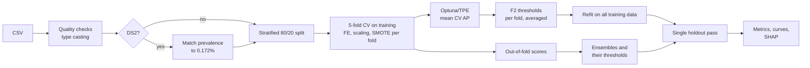

# credit-card-fraud-ml-detection

Code and experiments for evaluating machine learning classifiers, ensemble strategies and SHAP explanations in credit card fraud detection, using a strictly leakage-aware pipeline.

[](LICENSE)


This repository accompanies the article *Do Ensembles Pay Off? A Leakage-Aware Comparison of Optimized, Ensemble and SHAP-Explained Classifiers for Credit Card Fraud Detection Across Two Datasets* (submitted to *SN Computer Science*). It contains the full experimental pipeline, the extra analyses reported in the article and scripts that export the data behind every table and figure.

## Contents

- [Overview](#overview)
- [Main results](#main-results)
- [Repository layout](#repository-layout)
- [Installation](#installation)
- [Data](#data)
- [Reproducing the experiments](#reproducing-the-experiments)
- [Outputs](#outputs)
- [Leakage control](#leakage-control)
- [Configuration options](#configuration-options)
- [Tests](#tests)
- [Reproducibility notes](#reproducibility-notes)
- [Citation](#citation)
- [License](#license)

## Overview

Fraud is rare, so headline scores in credit card fraud detection depend on the evaluation protocol as much as on the algorithm. This project compares six optimized base classifiers and four ensemble strategies under one protocol. In that protocol, everything that learns from data is fitted on the training partition only, and the holdout set is scored once.

| Component | What is used |
|---|---|
| Base learners | Logistic regression, RBF support vector machine, random forest, XGBoost, LightGBM, CatBoost |
| Ensembles | Mean, AP-weighted mean, majority vote (3 of 6), stacking with a logistic-regression meta-learner |
| Imbalance handling | SMOTE inside training folds (XGBoost, LightGBM); balanced class weights (RF, CatBoost); threshold only (LR, SVM) |
| Tuning | Optuna with a TPE sampler, maximizing mean 5-fold cross-validated average precision (AP) |
| Decision threshold | F2-optimal threshold per fold, averaged over folds and fixed before holdout scoring |
| Metrics | AP, ROC-AUC, precision, recall, F2, MCC, confusion counts, Wilson 95% intervals |
| Explainability | SHAP for every base learner (Tree, Linear and Kernel explainers) and explanatory proxies for the ensembles |

Two public datasets are used:

- **DS1**: the 2013 European cardholder dataset, with 284,807 transactions and 0.173% fraud.
- **DS2**: a 2023 dataset with 568,630 transactions and 50% fraud. Its fraud class is undersampled to 0.172% before splitting, to match DS1.



## Main results

The table shows holdout AP from the article. Each holdout contains 98 frauds.

| Configuration | DS1 AP | DS2 AP |
|---|---:|---:|
| XGBoost | 0.875 | **0.929** |
| LightGBM | **0.877** | 0.924 |
| SVM (RBF) | 0.850 | 0.905 |
| Ensemble: AP-weighted | 0.876 | 0.904 |
| Ensemble: mean | 0.876 | 0.903 |
| CatBoost | 0.863 | 0.900 |
| Random forest | 0.867 | 0.891 |
| Ensemble: stacking | **0.877** | 0.891 |
| Logistic regression | 0.742 | 0.782 |
| Ensemble: majority vote* | 0.706 | 0.718 |

\* Computed from binary votes, so not directly comparable with the score-based values.

Tuned gradient boosting was the most reliable choice on both datasets. No ensemble beat the best single model on DS2. On DS1, stacking only tied LightGBM's AP, and it produced more false alarms at its operating point. Logistic regression reached a ROC-AUC of 0.969 and 0.991 but an AP of only 0.742 and 0.782, which is why AP is the primary criterion. With 98 holdout frauds, the leading configurations differ by a few transactions, within overlapping confidence intervals.

## Repository layout

```
ccfd/                 Python package
  config.py           settings, model plan and trial budgets (article defaults)
  data.py             loading, quality report, prevalence matching, stratified split
  features.py         log amount, cyclical hour, conditional scaling, fold-local SMOTE
  models.py           model factory, Optuna search spaces, fold and final fitting
  optimization.py     Optuna studies, trial tables, CV threshold statistics
  metrics.py          AP/ROC/P/R/F2/MCC, F2 threshold, confusion counts, Wilson intervals
  ensembles.py        out-of-fold scores, mean/weighted/majority vote/stacking
  explain.py          SHAP for base learners and ensemble proxies
  curves.py           exact PR/ROC export and pgfplots coordinates
  experiment.py       end-to-end run for one dataset
  compare.py          cross-dataset ranking and SHAP agreement
scripts/
  run_experiment.py         run the pipeline for DS1 or DS2
  compare_datasets.py       compare two finished runs
  paper_operating_points.py rebuild the article's operating-point table (no data needed)
  quicklook.py              PNG quick-look figures from a run
  make_synthetic.py         synthetic CSVs for smoke tests
tests/                unit tests
requirements.txt
```

## Installation

```bash
git clone https://github.com/Applied-Intelligence-Hub/credit-card-fraud-ml-detection.git
cd credit-card-fraud-ml-detection
python -m venv .venv
source .venv/bin/activate        # Windows: .venv\Scripts\activate
pip install -r requirements.txt
```

## Data

The datasets are not redistributed here. Download them from Kaggle and place them in `data/`:

| Name | Source | Suggested file name |
|---|---|---|
| DS1 | [mlg-ulb/creditcardfraud](https://www.kaggle.com/datasets/mlg-ulb/creditcardfraud) | `data/creditcard_2013.csv` |
| DS2 | [nelgiriyewithana/credit-card-fraud-detection-dataset-2023](https://www.kaggle.com/datasets/nelgiriyewithana/credit-card-fraud-detection-dataset-2023) | `data/creditcard_2023.csv` |

Both files must keep their original columns, including the binary `Class` label. The `id` column of DS2 is dropped automatically. If a file turns out to be a Git LFS pointer instead of the CSV, the loader stops with a message.

## Reproducing the experiments

These are the three steps for a full reproduction.

1. Run DS1. This takes several hours, mostly SVM and CatBoost tuning.

   ```bash
   python scripts/run_experiment.py --dataset ds1 --data data/creditcard_2013.csv --out outputs/ds1
   ```

2. Run DS2. The prevalence is matched to 0.172% automatically.

   ```bash
   python scripts/run_experiment.py --dataset ds2 --data data/creditcard_2023.csv --out outputs/ds2
   ```

3. Run the cross-dataset comparison: rank correlation, top-k SHAP frequency and Jaccard agreement.

   ```bash
   python scripts/compare_datasets.py --ds1 outputs/ds1 --ds2 outputs/ds2 --out outputs/compare
   ```

Two scripts help with checking:

- Quick-look figures from a finished run:

  ```bash
  python scripts/quicklook.py --run outputs/ds1
  ```

- The operating-point table, rebuilt from the published precision and recall (no data needed):

  ```bash
  python scripts/paper_operating_points.py
  ```

To check the installation without the real data (a smoke test that takes minutes, not hours):

```bash
python scripts/make_synthetic.py --out data_synthetic
python scripts/run_experiment.py --dataset ds1 --data data_synthetic/synthetic_ds1.csv \
       --out outputs/smoke --quick --subsample 0.3
```

Synthetic data and `--quick` runs are for testing the code only and must not be used to report results.

## Outputs

Each run writes the following files to its output directory.

| File | Content |
|---|---|
| `data_summary.json`, `outliers_per_feature.csv` | missing values, duplicates, IQR outliers, split sizes |
| `optuna_trials.csv`, `optimization_summary.csv`, `best_params.json` | every trial; best value, trial of the best, median, range, TPE gain; selected hyperparameters |
| `holdout_results.csv` | AP, CV AP SD, ROC-AUC, threshold, precision, recall, F2, MCC, TP/FP/FN/TN, alerts per 10k, FPR, Wilson intervals |
| `threshold_stability.csv` | the five per-fold F2 thresholds per learner, with mean and SD |
| `cv_vs_holdout.csv` | cross-validated AP against holdout AP |
| `ensemble_internals.csv` | AP-proportional weights and stacking-proxy coefficients |
| `shap/base_*.csv` | top-15 SHAP features per base learner (mean and SD of absolute values) |
| `shap/ensemble_*.csv` | raw and normalized SHAP contributions of each base learner within each ensemble |
| `curves/pr_*.csv`, `curves/roc_*.csv` | exact holdout precision-recall and ROC curves |
| `latex/pgfplots_coordinates.json` | ready-to-paste `\addplot coordinates {...}` strings (PR, ROC, Optuna convergence) |
| `holdout_scores.csv`, `oof_scores.csv`, `models/*.pkl` | raw scores and fitted models |

`compare_datasets.py` adds `cross_dataset_ap.csv`, `*_top5_frequency.csv`, `*_top10_frequency.csv`, `*_jaccard_top5.csv`, `*_jaccard_top10.csv`, `*_rank_matrix.csv` and `cross_dataset_stats.json`.

## Leakage control

The pipeline enforces these rules:

- **Prevalence matching before the split.** On DS2 the fraud class is undersampled before splitting, so training and holdout share the same rare-fraud regime.
- **Fold-local fitting.** Feature construction, min-max scaling and SMOTE are fitted inside every training fold. Validation folds and the holdout are never resampled.
- **Training-only selection.** Hyperparameters, decision thresholds, ensemble weights, ensemble thresholds and the stacking meta-learner are all chosen from training or out-of-fold data.
- **One holdout pass.** The holdout is scored once, after refitting on the full training partition. It is also the evaluation sample for SHAP.

Two known caveats are discussed in the article. Both can be switched on as corrections (see below):

- DS1 contains 1,081 exact duplicate rows, which a row-level split can place on both sides.
- CatBoost selects its best iteration on the evaluation set it receives during cross-validation.

## Configuration options

`scripts/run_experiment.py` accepts these flags:

| Flag | Effect |
|---|---|
| `--n-jobs N` | number of threads (defaults follow the original notebooks: -1 for DS1, 1 for DS2) |
| `--trials-scale F` | multiplies every Optuna budget (defaults: LR 80, SVM 40, others 60) |
| `--no-shap` | skips the explainability stage |
| `--fix-catboost-eval` | disables CatBoost best-iteration selection on CV evaluation sets |
| `--dedup` | drops exact duplicate rows before splitting |
| `--quick` | 3 trials per learner and light SHAP settings (smoke tests only) |
| `--subsample F` | keeps every fraud and a fraction F of legitimate rows (smoke tests only) |

The corrections are off by default, so a default run reproduces the published protocol. Every setting is defined in `ccfd/config.py`.

## Tests

```bash
python -m pytest -q tests
```

The tests cover the Wilson intervals, F2 threshold selection, the cyclical time features, train-only scaling, the DS2 prevalence counts (489 frauds kept) and the recovery of the article's confusion counts from the reported precision and recall.

## Reproducibility notes

- All random seeds are fixed at 42. The six Optuna studies share one seeded TPE sampler and run in a fixed order (LR, SVM, RF, XGBoost, LightGBM, CatBoost). Changing the order changes the trials each study sees.
- The original experiments ran on Python 3.8. With newer versions of scikit-learn, SHAP or the boosting libraries, results can differ slightly, mainly in SVM probabilities (Platt scaling) and in KernelExplainer sampling.
- Ensemble SHAP values describe explanatory proxies built on quantile-normalized scores. They are not exact decompositions of the predictive ensembles.
- SHAP attributions describe what a fitted model uses. They are not causal statements about fraud, and the anonymized predictors (V1 to V28) carry no business meaning.
- Wall-clock times depend on hardware and thread settings and are not results of the study.

## Citation

The article is currently under review. Citation details will be added here after publication.

```bibtex
@article{ccfd_leakage_aware_2026,
  title   = {Do Ensembles Pay Off? A Leakage-Aware Comparison of Optimized, Ensemble and
             SHAP-Explained Classifiers for Credit Card Fraud Detection Across Two Datasets},
  journal = {SN Computer Science},
  year    = {2026},
  note    = {Under review}
}
```

## License

This project is released under the GNU General Public License v3.0. See [LICENSE](LICENSE).

The datasets are subject to their own licenses and terms on Kaggle. This code is intended for research and education. It is not a production fraud detection system.
